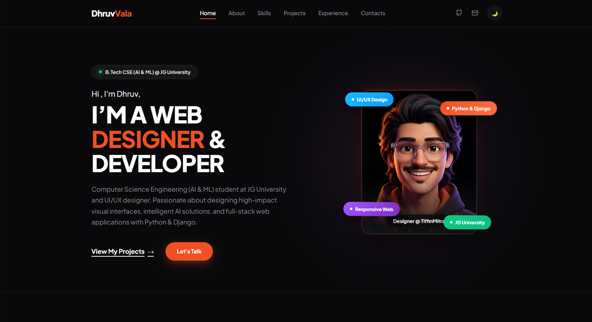

# Personal Portfolio Website - Dhruv Vala

> A dark editorial, 3D studio-inspired personal developer portfolio inspired by the **Figma Community** template (*"Portfolio Website design"* by Emad Abd Al Fatah) and built from scratch using pure **HTML5**, **CSS3**, and **JavaScript (ES6)**.

---

## 📌 Live Demo & Links
- **Portfolio Live Link (GitHub Pages):** `https://dhruv-1337.github.io/Dhruv_Vala_268480_Portfolio/`
- **Featured Project Prototype (TiffinMitra):** [https://tiffinmitraprototype.vercel.app](https://tiffinmitraprototype.vercel.app)
- **Design Inspiration:** [Figma Community - Portfolio Website Design](https://www.figma.com/community/file/1319634075055654983/portfolio-website-design)

---

## 📸 Portfolio Preview

*(Take a screenshot of your portfolio opened in your browser and name it `screenshot.png` in this folder)*

---

## 🧑‍💻 About Me
I am **Dhruv Vala**, currently pursuing **B.Tech in Computer Science & Engineering (AI & ML) at JG University, Ahmedabad**. I previously completed my Diploma in Information Technology from **Government Polytechnic Gandhinagar (GTU)** with a **7.95 CGPA**.

I specialize in **UI/UX Design**, **AI/ML Systems**, and **Full-Stack Web Development** using Python, Django, and modern web standards.

---

## 🎨 Theme & Visual Styling
- **Palette:** Jet Pitch Black (`#09090b`), Dark Charcoal Studio Surfaces (`#141416`), and Fiery Orange Brand Accents (`#f05023`).
- **Floating 3D Figma Capsules:** Interactive floating badges with glowing gradients in Sky Blue, Orange, Purple, and Teal.
- **Atmospheric Studio Smoky Glow:** Dynamic radial glow backdrop behind the visual showcase.
- **Editorial Typography:** High-impact all-caps main headline (`I'M A WEB DESIGNER & DEVELOPER`) paired with modern geometric sans-serif (*Plus Jakarta Sans*).
- **Interactive Underlined CTAs:** Modern editorial underline links alongside pill buttons.

---

## 🛠️ Technologies Used
- **HTML5:** Semantic markup (`<header>`, `<nav>`, `<main>`, `<section>`, `<article>`, `<footer>`, `<form>`).
- **CSS3:** Custom properties (CSS variables), Flexbox, CSS Grid, keyframe floating animations, hover states, and responsive media queries (`@media`).
- **JavaScript (ES6+):** DOM manipulation, event listeners, localStorage theme state, and real-time client-side form validation.

---

## ✨ Key Features
1. **🌓 Dark & Light Studio Theme Switcher:**
   - Seamlessly toggle between a pitch-black studio look and a clean minimalist light theme.
   - Saves your theme preference in the browser's `localStorage`.
2. **📱 Responsive Mobile Navigation:**
   - Interactive hamburger menu with animated drawer toggle for mobile and tablet screens.
   - Automatically collapses when navigating to a section.
3. **📋 Interactive Contact Form Validation:**
   - Custom client-side validation ensuring valid email format, minimum characters, and required fields.
   - Inline error warnings and real-time reset as you type.
4. **🍱 Showcase of Featured Projects:**
   - **TiffinMitra:** Tiffin service provider application (UI/UX Design & Python Frontend) with active live link.
   - **Carvilla:** Automotive showcase and rental web platform built with Python & Django.
   - **AI Food Ordering Chatbot:** Conversational assistant built during the IBM SkillsBuild internship.

---

## 📂 Project Structure
```text
Dhruv_Portfolio/
│
├── index.html        # Semantic HTML structure & sections
├── style.css         # Figma studio styling, animations & responsive media queries
├── script.js         # Interactive JS (theme toggle, mobile nav, form validation)
├── README.md         # Documentation, technologies used, and live links
└── screenshot.png    # Screenshot preview of the website
```

---

## 🚀 How to Run Locally
1. Clone this repository:
   ```bash
   git clone https://github.com/<your-username>/<Name_RollNo_Portfolio>.git
   ```
2. Navigate into the project folder:
   ```bash
   cd <Name_RollNo_Portfolio>
   ```
3. Double-click `index.html` to open it directly in Google Chrome, Edge, or Firefox (or use the VS Code "Live Server" extension).

---

## 📜 Academic Integrity & Submission
- **Author:** Dhruv Vala
- **University:** JG University
- **Subject:** Web Technology (Internal Assessment Project)
- **Guidelines Compliance:** Written from scratch without copied third-party frameworks/templates; no sensitive private credentials, phone numbers, or residential addresses are exposed.
